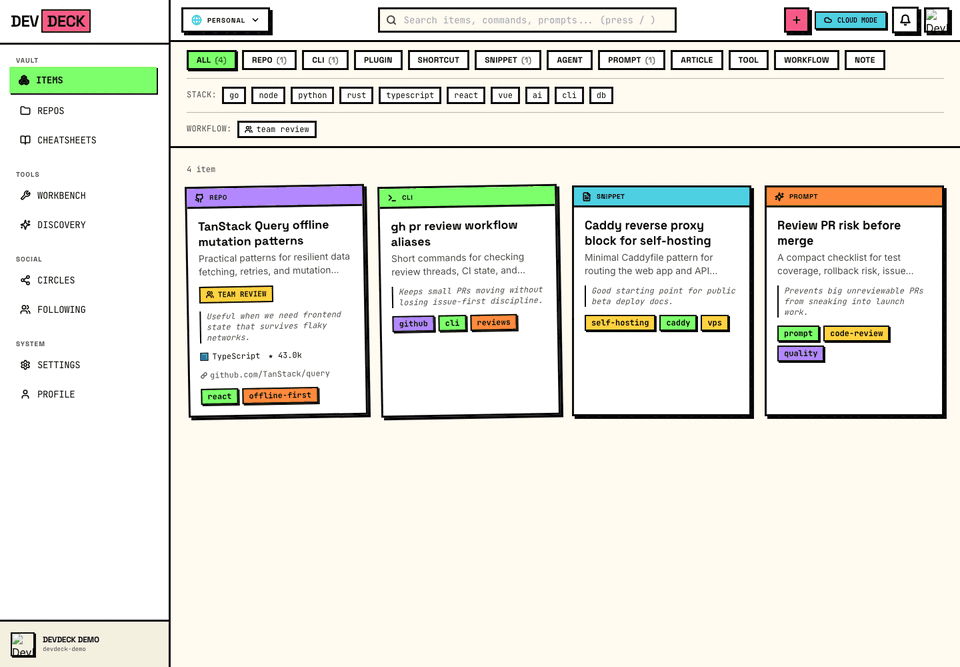
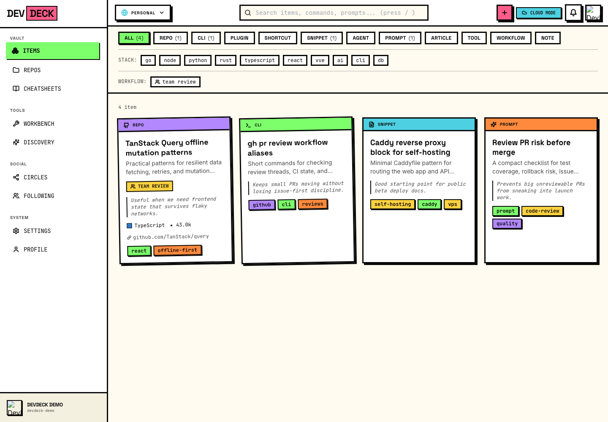
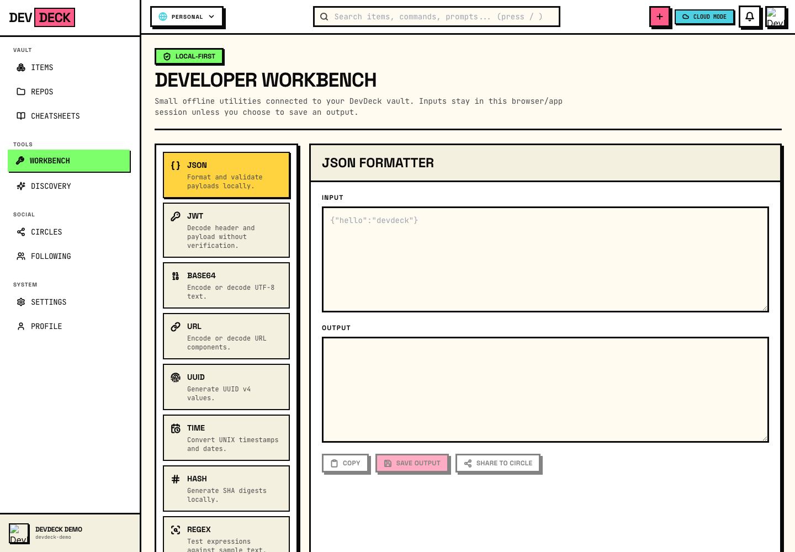
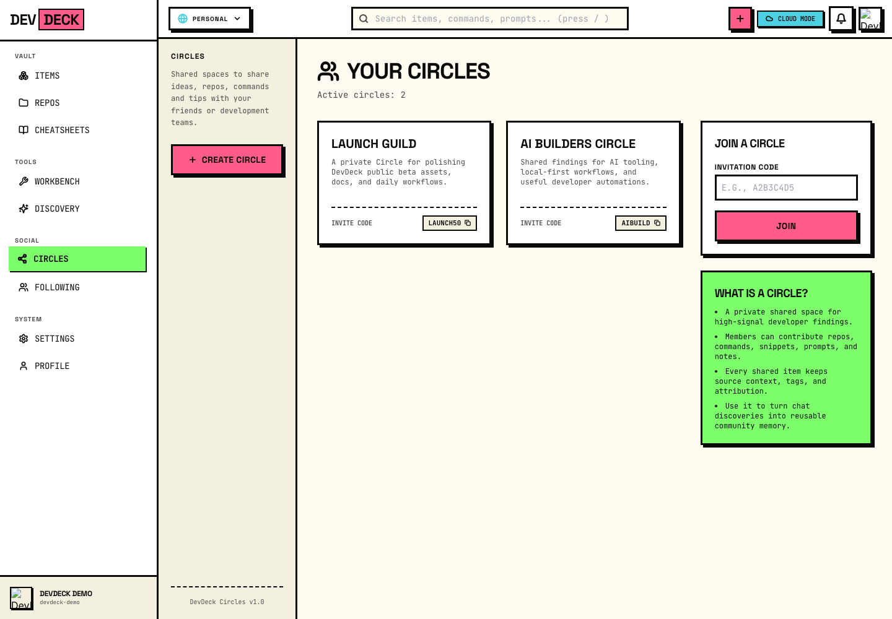
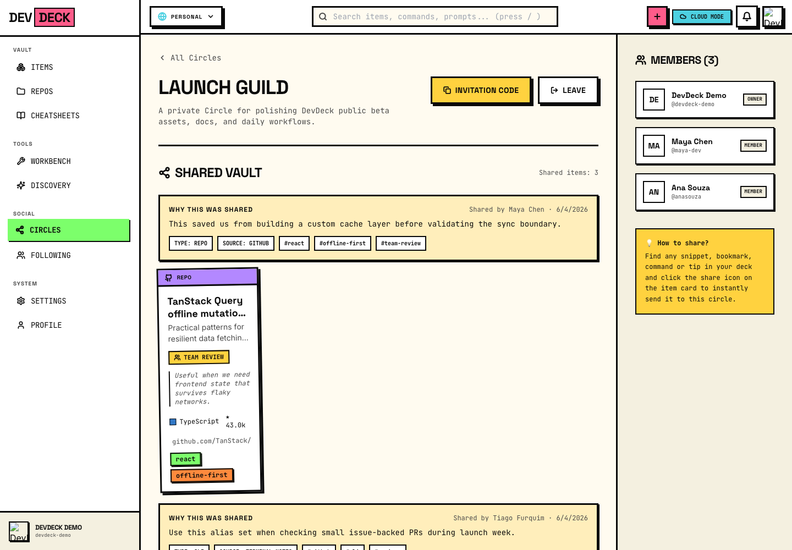

# HeapDeck.com

[](https://github.com/tiagofur/heapdeck/actions/workflows/ci.yml)
[](https://heapdeck.com)
[](CHANGELOG.md)
[](LICENSE)

> **Tu memoria externa asistida por IA para el trabajo de desarrollo.**

> 🚀 **Beta pública viva — [probá HeapDeck ahora mismo, sin instalar nada](https://heapdeck.com/register).** Creá una cuenta gratis con tu email y guardá tu primer repo, CLI o snippet en menos de un minuto.

Una app **offline-first, multi-usuario y multiplataforma** donde guardar, organizar y redescubrir todo lo útil que un dev encuentra: repos, CLIs, plugins, cheatsheets, shortcuts, snippets, agentes, prompts y workflows. Con IA que clasifica, resume y recupera por intención — no por tag exacto.

Dominio: **[heapdeck.com](https://heapdeck.com)** — la app web corre ahí directamente ([registro](https://heapdeck.com/register) · [login](https://heapdeck.com/login)); API en `https://api.heapdeck.com`.

Versión actual: **0.6.0 Beta Pública** — funcional, útil y en polish activo antes de un 1.0 estable.

[English](README.md) · [Roadmap](ROADMAP.md) · [Contribuir](CONTRIBUTING.es.md) · [Discusiones](https://github.com/tiagofur/heapdeck/discussions) · [Guía de discusiones](docs/DISCUSSIONS.md) · [Soporte](docs/SUPPORT.md) · [Modelo de comunidad](docs/CIRCLES_COMMUNITY.md)

---

## ¿Por qué HeapDeck? (el loop diario)

1. **Capturá** un repo, CLI, snippet, atajo, prompt, artículo, runbook o nota.
2. **Agregá contexto**: por qué importa, cuándo usarlo, tags, fuente y gotchas.
3. **Recuperá por intención** con búsqueda fuzzy y semántica, no solo nombres exactos.
4. **Usalo en el Workbench** para workflows reusables, snippets, requests y contexto de proyecto.
5. **Compartí a Circles** para que un grupo construya memoria colectiva en vez de perder señal en el chat.

## Screenshots y demo



Capturas generadas con datos demo locales, no con registros privados de usuarios.

| Vault | Workbench |
|-------|-----------|
|  |  |
| *Guardá repos, CLIs, snippets, prompts y atajos con contexto.* | *Utilities locales reusables, snippets, requests y runbooks.* |

| Circles | Vault compartido de un Circle |
|---------|-------------------------------|
|  |  |
| *Espacios privados compartidos para grupos de confianza.* | *Hallazgos con contexto, atribución y metadata de fuente.* |

El path demo central es: capturar artefactos útiles, agregar contexto, usarlos en el Workbench y compartir los hallazgos con un Circle de confianza.

Ver [docs/assets/launch/README.md](docs/assets/launch/README.md) para regenerar estos assets.

---

## Stack

- **Desktop:** Electron + React 18 + TypeScript + Tailwind + Framer Motion
- **Web:** React 18 + Vite + React Router + TanStack Query (comparte 100% de pages y componentes con Desktop)
- **Backend:** Go + Chi + pgx + pgvector
- **DB:** Postgres 16 (con `pg_trgm` + `pgvector` para búsqueda fuzzy y semántica)
- **IA:** OpenAI API / Ollama (local)
- **Offline:** SQLite local (Electron) + sql.js/OPFS (Web)
- **Deploy:** VPS propio · Docker Compose · Caddy (TLS automático)
- **Dominio:** [heapdeck.com](https://heapdeck.com) (app web) · `api.heapdeck.com` (API Go)

### Layout del repo (monorepo pnpm workspaces)

```
heapdeck/
├── apps/
│   ├── desktop/          # App Electron (renderer React)
│   ├── extension/        # Extensión de browser (Manifest V3)
│   ├── landing/          # Landing de marketing (Astro, sin deploy aún)
│   └── web/              # App web (React + BrowserRouter)
├── packages/
│   ├── ui/               # Design system: Button, TagChip, Toaster, tailwind-preset
│   ├── api-client/       # Fetch wrapper + hooks TanStack Query + auth adapters
│   ├── features/         # Pages + componentes de dominio (compartidos entre apps)
│   ├── i18n/             # Recursos de idioma
│   └── realtime-client/  # Cliente de colaboración realtime
├── backend/              # API Go (Chi + pgx + Postgres 16)
├── cli/                  # CLI `heapdeck` (Go)
├── deploy/               # Docker Compose + Caddy
└── docs/                 # Documentación
```

Ambas apps importan pages y componentes del package `@heapdeck/features` — solo difieren en el shell (HashRouter + PasteInterceptor en desktop, BrowserRouter + AuthGuard en web). Ver [docs/adr/0003-monorepo-pnpm-workspaces.md](docs/adr/0003-monorepo-pnpm-workspaces.md).

---

## Screenshots

*Ver [Screenshots y demo](#screenshots-y-demo) arriba.*

---

## Documentación

### Producto y visión
| Doc | Contenido |
|-----|-----------|
| [docs/VISION.md](docs/VISION.md) | Visión, posicionamiento, diferenciadores |
| [docs/PRD.md](docs/PRD.md) | Producto, features, user stories, scope por olas |
| [docs/DEV_WORKBENCH.md](docs/DEV_WORKBENCH.md) | Developer Workbench: utilities locales, paleta y acciones reutilizables |
| [docs/COMPETITIVE_ANALYSIS.md](docs/COMPETITIVE_ANALYSIS.md) | Análisis competitivo detallado |
| [docs/LANDING.md](docs/LANDING.md) · [docs/LANDING_COPY.md](docs/LANDING_COPY.md) | Copy de landing (ES / EN) |

### Arquitectura y decisiones
| Doc | Contenido |
|-----|-----------|
| [docs/ARCHITECTURE.md](docs/ARCHITECTURE.md) | Diagrama, stack, schema DB |
| [docs/API.md](docs/API.md) | OpenAPI spec |
| [docs/DESIGN_SYSTEM.md](docs/DESIGN_SYSTEM.md) | Tokens, paleta, tipografía |
| [docs/TECHNICAL_ROADMAP_AI_OFFLINE.md](docs/TECHNICAL_ROADMAP_AI_OFFLINE.md) | Roadmap técnico: offline, sync, IA |
| [docs/adr/0001-items-polymorphism.md](docs/adr/0001-items-polymorphism.md) | ADR: modelo polimórfico de items |
| [docs/adr/0002-sync-strategy.md](docs/adr/0002-sync-strategy.md) | ADR: estrategia de sync offline-first |
| [docs/adr/0003-monorepo-pnpm-workspaces.md](docs/adr/0003-monorepo-pnpm-workspaces.md) | ADR: monorepo pnpm workspaces + React en web |

### Operación y contribución
| Doc | Contenido |
|-----|-----------|
| [cli/README.md](cli/README.md) | Instalación y uso real del CLI `heapdeck` (P0) |
| [docs/SELF_HOSTING.md](docs/SELF_HOSTING.md) | Guía paso a paso para self-host |
| [docs/CAPTURE.md](docs/CAPTURE.md) | Spec de canales de captura (extensión, CLI, paste, share) |
| [docs/TESTING_STRATEGY.md](docs/TESTING_STRATEGY.md) | Plan de tests y CI |
| [docs/LIMITATIONS.md](docs/LIMITATIONS.md) | Limitaciones conocidas de la 0.6.0 Public Beta |
| [docs/ARCHITECTURE_MAP.md](docs/ARCHITECTURE_MAP.md) | Mapa de arquitectura en una página para contribuidores |
| [docs/archive/REVIEW_2026_04.md](docs/archive/REVIEW_2026_04.md) | **Review técnico de abril 2026** — motiva Ola 4.5 |
| [CONTRIBUTING.md](CONTRIBUTING.md) | Cómo contribuir |
| [SECURITY.md](SECURITY.md) | Política de seguridad |

---

## Estado

Versión actual: **0.6.0 Beta Pública** — [beta viva en heapdeck.com](https://heapdeck.com/register), funcional y en polish activo rumbo a 1.0.

HeapDeck es un producto open-source en evolución. La dirección actual es fortalecer el vault, los flujos de captura, la recuperación semántica y el **Developer Workbench**: utilities locales, paleta, requests reutilizables, snippets y runbooks conectados al contexto guardado.

Ver [ROADMAP.md](ROADMAP.md) y [docs/DEV_WORKBENCH.md](docs/DEV_WORKBENCH.md) para la dirección de producto.
